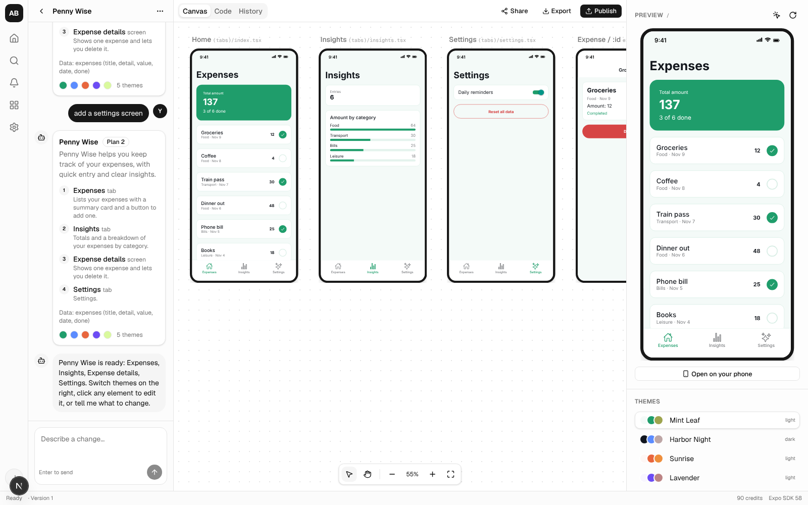

# App Builder (working title)

A prompt-to-mobile-app platform. Describe an app; an AI agent plans its screens and builds an
Expo / React Native app. Edit it by chat or by clicking elements, preview it in the browser and
on your phone, export the source or push it to GitHub, build for Android and iOS, and publish it
to the web.



**Status:** the app works end to end. See [v1 status](docs/05-v1-status.md) for what's
verified, what needs your accounts, and what's left.

## Getting started

Requires Node 22, **npm 11** (npm 10 can't install this dependency tree) and Postgres 16.

```bash
npm install -g npm@11
```

```bash
docker compose up -d
```

```bash
cp .env.example .env
```

Edit `.env`: set `ANTHROPIC_API_KEY` for AI generation, or `LLM_PROVIDER=fake` to try the app
with the offline template generator. Then:

```bash
npm install
```

```bash
npm run db:migrate
```

```bash
npm run dev
```

That starts three processes: the app on http://localhost:3000, the preview runtime on
http://localhost:3001 (a separate origin, by design), and the worker that runs the agents.

| Command | What it does |
|---------|--------------|
| `npm test` | Unit and integration tests (Vitest; uses Postgres) |
| `npm run test:e2e` | End-to-end tests (Playwright; starts everything with the offline generator) |
| `npm run typecheck` / `npm run lint` / `npm run format:check` | Static checks |
| `npm run build` | Production build of the preview runtime and the app |
| `npm run spike:generate` | Generate one screen with Claude (needs `ANTHROPIC_API_KEY`) |
| `npm run spike:snack-check` | Show which Expo SDKs Snack supports |

## Repository

| Path | What it is |
|------|------------|
| `apps/web` | Next.js app: pages, API routes, auth (Better Auth) |
| `apps/preview` | Preview runtime: runs generated apps with react-native-web in sandboxed iframes |
| `apps/worker` | Job runner: plan/build/edit agents, GitHub pushes, EAS builds, phone-preview dev servers |
| `packages/contract` | The generated-app contract: SDK pins, allowed imports, validator, route model, inline-edit write-back |
| `packages/core` | Server-side domain logic: projects, versions, runs, credits, permissions, storage |
| `packages/db` | Drizzle schema and migrations |
| `templates/expo-app` | Fixed files every generated app starts from |
| `fixtures/habit-tracker` | A hand-written app used by the preview tests |

## Docs

1. [Transcript review](docs/01-transcript-review.md): the reference course, what it skips, and decisions.
2. [Architecture](docs/02-architecture.md): system design, contract, data model, agents, preview.
3. [Build plan](docs/03-build-plan.md): phases and their status.
4. [Phase 0 results](docs/04-phase-0-results.md): what the spikes proved (including why Snack can't be used).
5. [v1 status](docs/05-v1-status.md): what's built and verified.
