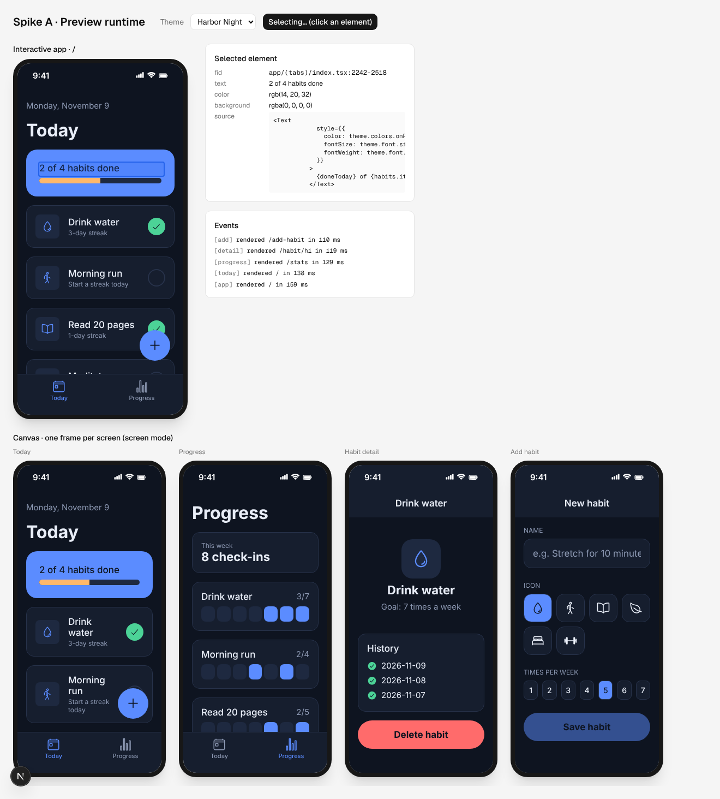

# Phase 0 results: foundations and spikes

Phase 0 had one job: retire the biggest technical risks before building product UI. This page
records what was built, what each spike proved, what changed in the plan, and what is still
open. Plan: [03-build-plan.md](03-build-plan.md). Design: [02-architecture.md](02-architecture.md).

| Item | Status | Evidence |
|------|--------|----------|
| Monorepo, Next.js, shadcn/ui, Drizzle, Better Auth | ✅ done | Production build passes; sign-up writes `user` + `session` rows in Postgres |
| Contract v0 + validator + Expo template | ✅ done | 25 unit tests; template passes `expo install --check` for SDK 58 |
| **Spike A** · preview runtime | ✅ proven | 7 Playwright e2e tests (navigation, data, theme, select, isolation) |
| **Spike B** · on-device preview | ⚠️ plan changed | Snack can't run SDK 58; Expo's dev server path verified up to the manifest and bundle Expo Go loads |
| **Spike C** · generation | 🟡 built, live run pending | Loop + prompt unit-tested with a fake client; needs an Anthropic API key to run live |
| CI | ✅ written | `.github/workflows/ci.yml` (format, lint, typecheck, unit, migrate, build, e2e); first run happens on GitHub |



---

## Repository layout

```
apps/web          Next.js 16 app (App Router, Cache Components) — product UI, auth, API
apps/preview      Preview runtime: served from its own origin, runs generated code in sandboxed iframes
apps/worker       Long-running jobs (Phase 3+); Phase 0 spikes live in src/spikes/
packages/contract The generated-app contract: SDK pins, allowed imports, validator,
                  route model, click-to-select instrumentation, preview protocol
packages/db       Drizzle schema, migrations, client
templates/expo-app  Fixed template files every generated app starts from
fixtures/habit-tracker  A hand-written "generated" app used by the spikes and tests
```

## Spike A — preview runtime (proven)

A hand-written habit tracker (2 tabs, a stack detail screen with a route param, a form)
renders as React Native Web inside sandboxed iframes on a separate origin.

**What works** (each item covered by an e2e test in `apps/web/e2e/preview-runtime.spec.ts`):
- Expo Router semantics from file paths: root Stack, `(tabs)` group with a tab bar, a stack
  screen with a header and back button, `useLocalSearchParams`, `Link asChild`, and titles set
  from inside a screen with `<Stack.Screen options />`.
- The template's data layer: seed data on first read, writes through `useCollection`, live
  re-render on change (check a habit off, add a habit through the form).
- **Instant theme switching** in every frame, with no reload.
- **Click-to-select:** a click resolves to the exact source span of the element
  (`app/(tabs)/index.tsx:2242-2518` → the `<Text>` that renders "2 of 4 habits done"). Select
  mode swallows input, so the app doesn't react.
- **Screen mode** for canvas frames: navigation is reported to the parent, not performed.
- **Isolation:** inside a frame, `window.parent.document`, `document.cookie` and
  `localStorage` all throw `SecurityError`, and the origin is `"null"`. The preview server
  sends a CSP with `frame-ancestors` limited to the app origin and `connect-src 'none'`.

**Numbers** (dev build, 5 frames loading at once): 110–300 ms from `load` to first paint per
frame. Production runtime bundle: 1.0 MB minified (React, react-native-web, Babel parser,
Sucrase, shims).

**Known limits (v0):** screens below the top of a stack unmount (form state resets on back);
no navigation transitions or modals; no nested navigators inside a tab; AsyncStorage is in
memory and resets on reload; only Ionicons are available.

## Spike B — on-device preview (plan changed)

**Finding: Snack cannot open apps on a current phone.** Snack runs projects inside Expo Go by
loading its "Snack runtime", which Expo publishes as an EAS Update per SDK. Querying the update
service directly (`npm run spike:snack-check`) on 2026-11-09:

| SDK | Snack runtime (iOS / Android) |
|-----|-------------------------------|
| 58 (current Expo Go) | ❌ / ❌ |
| 57 | ❌ / ❌ |
| 56 | ❌ / ❌ |
| 55 | ✅ / ✅ |
| 54 | ✅ / ✅ |

Store builds of Expo Go only run the latest SDK, so a Snack QR code fails on an up-to-date
phone. The latest `snack-sdk` on npm (6.6.2) also lists only SDKs 50–54. This is the version
trouble the reference video hit.

**What works instead: Expo's own dev server (Metro).** Verified here with the real SDK 58
toolchain, on template + fixture:
1. `expo install --check`: "Dependencies are up to date", so the template's pins are exact.
2. `tsc` against real Expo, React Native and expo-router types found **one real bug** in the
   hand-written fixture (SDK 58's tab-bar `color` is a `ColorValue`, which `Ionicons` doesn't
   accept). Fixed with `color as string`, and the rule was added to the generation prompt.
3. `expo export --platform ios --platform android`: Hermes bundles for both platforms.
4. `expo start`: the manifest reports `runtimeVersion: exposdk:58.0.0` (what current Expo Go
   expects), and the dev bundle (6.4 MB) compiles in about 9 s cold. Dependency install takes
   about 20 s on first run.

**Not verified here:** scanning with a physical phone. This environment blocks opening a
public tunnel, and Expo Go on a phone needs to reach the dev server. To try it on your machine,
with the phone on the same Wi-Fi:

```bash
npm run spike:device
```

Use `npm run spike:device -- --tunnel` if the phone is on another network.

**Consequence:** Phase 6 grows from M to L. It needs per-session dev servers in the worker,
a prebuilt image with the template's `node_modules`, and a public hostname per session.

## Spike C — generation (built; live run pending)

`apps/worker/src/generation/` generates one file against the contract:
- The **system prompt is built from the contract's own constants** (allowed modules, SDK), so
  what the model is told and what the validator enforces can't drift. Rules and project
  context form a stable, cached prefix.
- **write → validate → repair** (up to 2 repairs). The conversation is append-only: each repair
  sends the previous assistant turn back unchanged and adds the validator's findings.
- Streaming, explicit effort, server-side refusal fallback, and stop-reason checks (truncated
  or refused output is never validated as if it were complete).
- Code comes back as plain text, not JSON (no escaping overhead; lines can be counted for
  progress). Plans will use structured outputs in Phase 3.
- Token usage and estimated cost are recorded per run, for credit pricing later.

**Not run live:** this cloud environment authenticates Anthropic hosts with its own session
token, which the API rejects for direct use, and it doesn't accept a user key for those
hosts. To run it on your machine:

```bash
ANTHROPIC_API_KEY=sk-ant-... npm run spike:generate
```

That generates an Insights tab for the fixture, validates and repairs it, and writes the file
plus a `report.json` (attempts, tokens, estimated cost) to `.spike-output/generated/`.

## Foundations

- **npm 11 is required.** npm 10's resolver crashes (`Cannot read properties of null (reading
  'edgesOut')`) on better-auth's optional peer set. The repo pins `packageManager:
  npm@11.21.2`, and CI installs it.
- **Better Auth 1.7.18** (1.6.x has a critical advisory). Email/password works end to end;
  Google and GitHub sign-in are Phase 1.
- **Drizzle** schema for Better Auth's tables plus a first migration; `npm run db:migrate`.
- **Preview origin headers:** the dev server sends them, and the build writes `dist/_headers`
  for static hosts. Production hosting for the preview origin is still to be chosen.
- `npm audit`: no high or critical findings; 19 moderate and 2 low, all in dev/build tooling
  (drizzle-kit's esbuild, glob, minimatch).

## Follow-ups (not blocking Phase 1)

1. **Typecheck in the validator.** Spike B showed that `tsc` against real SDK types catches
   bugs the AST rules can't. Add it to the Phase 4 pipeline (worker-side, against the
   template's installed types).
2. **Slim the install.** `@expo/vector-icons` pulls `expo` and `react-native` in as
   auto-installed peers just so the preview can read the Ionicons glyph map and font. Vendor
   those two files to cut about 1 GB of `node_modules`.
3. **Persist preview data** across reloads (via the parent window) if users expect it.
4. **Choose hosting for the preview origin** and apply `dist/_headers` there.

## How to run locally

```bash
docker compose up -d
```

```bash
npm install
```

```bash
npm run db:migrate
```

```bash
cp .env.example apps/web/.env.local
```

```bash
npm run dev
```

Then open http://localhost:3000/spikes/preview.

```bash
npm test
```

```bash
npm run test:e2e
```
