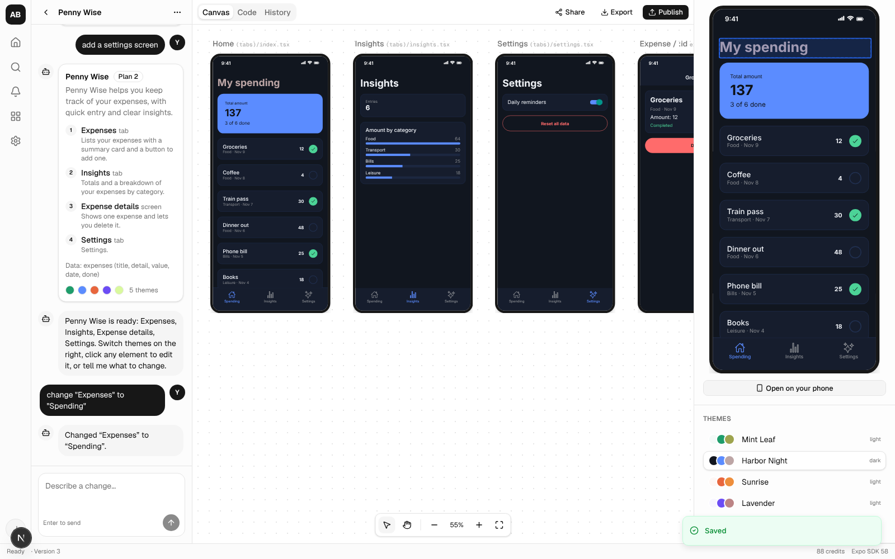

# v1 status: what's built, what's verified, what's left

The app is built end to end on the wireframe layout. Phases 1–7 and 10–12 of the
[build plan](03-build-plan.md) are implemented. Phase 8 (backends for generated apps) and
Phase 9 (AI images) are not, and Phase 13 (production deploy) needs your hosting and accounts.
This page says exactly what was verified here and what still needs real credentials.


## The UI, mapped to the wireframe

| Wireframe area | Dashboard | Project workspace |
|----------------|-----------|-------------------|
| **Left rail** | Home · Search (⌘K) · Activity · Community · Settings · account menu at the bottom | same |
| **Sidebar** | Your projects, with a filter | Agent chat: messages, plan cards with **Confirm & build**, live build progress, composer |
| **Tabs** | Create · My projects · Shared with me · Community | Canvas · Code · History, with Share / Export / Publish on the right |
| **Main content** | Prompt box (with reference images) and project cards with live thumbnails | Canvas of every screen running live (pan, zoom); code browser; version history with restore |
| **Right sidebar** | Credits and plan · Activity · Tips | Interactive preview · element inspector · theme list · **Open on your phone** |
| **Bottom bar** | Plan and credits · SDK | Run status / step · version · credits · SDK |



## Features

- **Accounts:** email and password; Google and GitHub sign-in when their OAuth keys are set.
  100 credits on sign-up.
- **Create:** a prompt with up to 5 reference images (type-checked from file contents, 10 MB
  each) and a platform choice. A prompt typed on the landing page survives sign-up.
- **Plan → revise → build:** the agent proposes a plan (screens, data, 5 themes). You revise
  it in chat ("add a settings screen"), then confirm. The build streams progress, and screens
  appear on the canvas as each one finishes.
- **Edit by chat:** every change is validated against the contract and saved as a new version.
  Edits are limited by your plan's screen count.
- **Edit by clicking:** select mode in any preview. The inspector edits literal text, theme
  colors, font size, padding and corners, and writes them back into the exact source. Computed
  text sends you to "Edit with AI" with the element attached.
- **Themes:** switch between the app's 5 packs instantly in every frame; the choice is saved.
- **History:** every build, AI edit, inspector edit and restore is a version; restore any of them.
- **Phone preview:** a per-project Expo dev server and a QR code for Expo Go (SDK 58), with
  live updates. Idle servers stop after 15 minutes.
- **Export:** zip download (Expo project with README and `eas.json`); push to GitHub (new repo,
  or an existing repo via a branch and pull request); Android/iOS builds with EAS (Pro, uses
  your Expo token).
- **Share:** invite by email as viewer or editor. Viewers can look and remix; editors can
  change; only the owner can publish, change visibility, share or delete.
- **Publish:** a public web URL (`/p/<slug>`) serving the published version, and an option to
  list the app in the community gallery, where anyone can try it or remix a copy.
- **Plans and credits:** Free (2 projects, 5 screens per app) and Pro (unlimited projects, 12
  screens, native builds, monthly credits) via Stripe Checkout, the customer portal and webhooks.
  Each run reserves credits, which are also its spending cap: the worker stops a run when its
  measured model cost reaches the reserve. A run is charged its measured cost (at least a small
  minimum when it succeeds, never more than its reserve). Failed or cancelled runs pay only for
  the model usage they consumed, and nothing if they never reached the model.

## How it's verified

| Check | Result |
|-------|--------|
| Unit and integration tests (Vitest, 48 tests) | ✅ contract rules, inline-edit write-back, route model, the agent pipeline, GitHub push sequence (mocked API), credits/versions/run-queue/permissions against real Postgres (including concurrent credit reservations and exactly-once run claiming) |
| End-to-end (Playwright, 10 tests) | ✅ landing → sign-up → plan → revise → build → navigate → chat edit → theme → inspector edit → computed-text guard → restore → code → zip → publish → public page → community; sharing (stranger 404, editor edits, can't publish); free-plan limits |
| Phone preview through the UI | ✅ QR ready in 36 s on first use (one-time SDK install); the dev server serves an `exposdk:58.0.0` manifest and compiles the generated app (6.4 MB bundle) |
| Lint, typecheck (all workspaces), production build | ✅ |

**What these runs used:** the worker ran with `LLM_PROVIDER=fake`, an offline template
generator, because this environment has no usable Anthropic credentials. It answers the same
requests in the same formats, so everything except the model itself (jobs, validation, repair,
versions, credits, preview, export, publishing) ran for real. The Claude path
(`apps/worker/src/generation/client.ts`) is covered by unit tests with a fake client but has
**not been run live**.

## Security review

An independent review of the server code (permissions on every route, credits, billing,
uploads, the worker's file and process handling) found these issues. All are fixed and covered
by tests:

| Finding | Fix |
|---------|-----|
| A generated file path like `components/../app.config.ts` could escape the project folder when the worker writes files for phone previews or builds (and `app.config.ts` runs on the worker) | The validator rejects unsafe paths, and the worker refuses to write outside its folder; `require()` and dynamic `import()` are rejected too |
| Runs could cost more than they reserved, pushing balances negative | Charges are capped at the reserve, and the worker stops a run when its cost reaches it |
| Cancelling a build after its screens streamed back refunded everything | Failed and cancelled runs pay their measured usage |
| Stripe `invoice.paid` arriving before checkout completion dropped the first month's credits | The user is found from the subscription's metadata, and Stripe retries otherwise; credits are granted only for new and renewal invoices |
| A run that crashed the worker 3 times stayed "running" forever, locking the project | A reaper fails abandoned runs and releases their credits |
| Remixing a public app copied its private prompt and plan | Public remixes copy only the files |
| Child processes inherited the worker's secrets, and `eas-cli@latest` ran unpinned | Child processes get a minimal environment; eas-cli is pinned |
| Phone-preview startup blocked the job queue | It runs in the background |
| Two concurrent chat messages could start two edits; concurrent inspector edits could overwrite each other | One agent run per project is enforced in the database; inspector edits fail with a conflict instead of overwriting |

**Still open (by design until Phase 13):**

- Sharing is keyed on email, and email verification isn't required yet. Someone who signs up
  first with an invited address gets that project. Turn on email verification before launch.
- Phone-preview dev servers are local processes, so run them on one worker
  (`DEVICE_PREVIEW_ENABLED=0` on the others).

## What needs your accounts (not verified here)

| Feature | What to provide | Status |
|---------|-----------------|--------|
| AI generation with Claude | `ANTHROPIC_API_KEY` | Built and unit-tested, never run live; quality untuned |
| Google / GitHub sign-in | OAuth client IDs and secrets | Wired through Better Auth, untested |
| Pro upgrades | `STRIPE_SECRET_KEY`, `STRIPE_WEBHOOK_SECRET`, `STRIPE_PRICE_PRO` | Built; webhook handler untested against Stripe |
| Push to GitHub | A user's fine-grained token (Settings) | Request sequence unit-tested; never run against GitHub |
| Android/iOS builds | A user's Expo token (Settings); Apple account for iOS | Built; never run against EAS |
| Phone on another network | `DEVICE_PREVIEW_TUNNEL=1` or a public host | Untested (tunnels are blocked here) |
| S3 / R2 storage | `S3_*` variables | Adapter written; local files used here |

## Not built yet

1. **Backends for generated apps (Phase 8).** Apps store data on the device. The data layer
   (`useCollection`) is ready for a remote implementation once the provider decision is made.
2. **AI images (Phase 9).** No ImageKit integration yet.
3. **Hardening (Phase 13):**
   - rate limits on run creation and uploads
   - email verification before generating
   - error monitoring
   - an image with the Expo runtime preinstalled for the worker
   - production hosting for the preview origin (`apps/preview/dist/_headers` has its headers)
4. **Quality work:**
   - an eval set for real model output
   - a typecheck step against SDK types in the validator (Phase 0 follow-up)
   - persisting preview data across reloads

## Run it

See the [README](../README.md). In short:

```bash
cp .env.example .env
```

Set `LLM_PROVIDER=fake` (no AI) or `ANTHROPIC_API_KEY`, then:

```bash
npm install && npm run db:migrate && npm run dev
```
