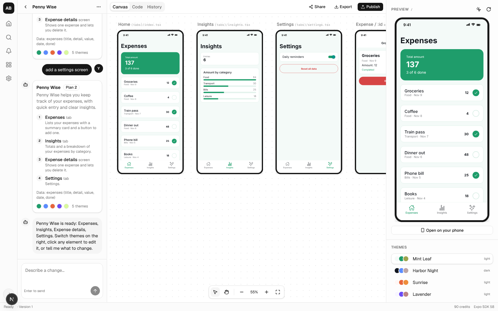
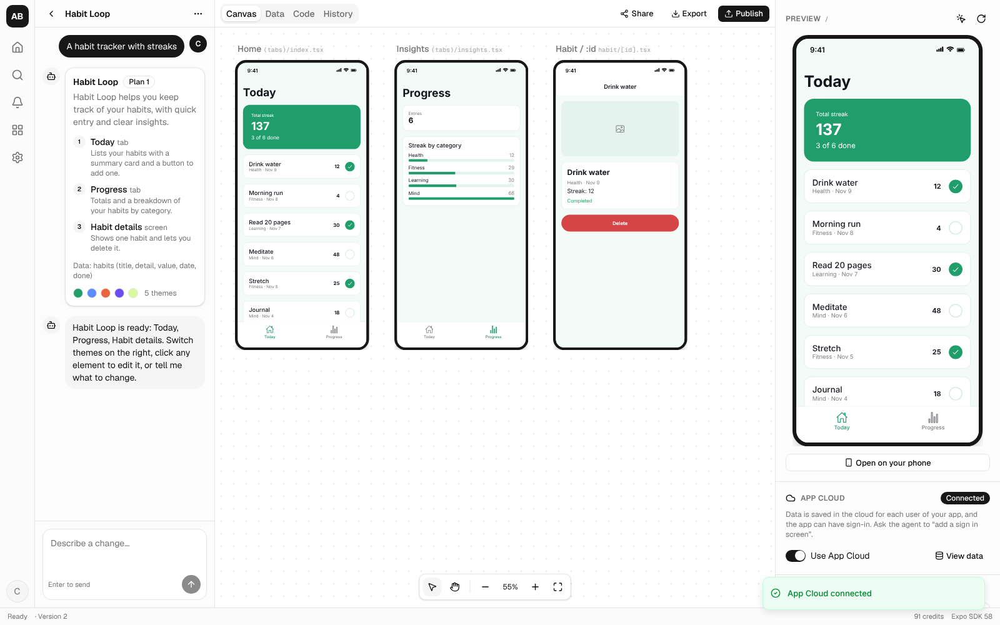
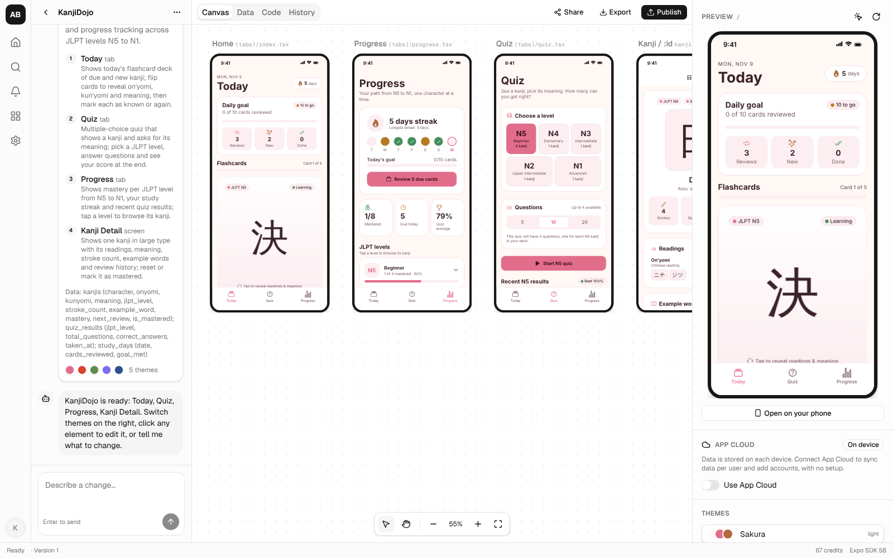

# v1 status: what's built, what's verified, what's left

Every phase of the [build plan](03-build-plan.md) is implemented, on the wireframe layout.
What remains needs your accounts and hosting: live runs against Anthropic, Stripe, GitHub,
EAS, ImageKit and Resend, connecting a real Claude or ChatGPT account over MCP, and a
production deployment ([06-deploy.md](06-deploy.md) has the
steps). This page says exactly what was verified here and what wasn't.



## The UI, mapped to the wireframe

| Wireframe area | Dashboard | Project workspace |
|----------------|-----------|-------------------|
| **Left rail** | Home · Search (⌘K) · Activity · Community · Settings · account menu at the bottom | same |
| **Sidebar** | Your projects, with a filter | Agent chat: messages, plan cards with **Confirm & build**, live build progress, composer |
| **Tabs** | Create · My projects · Shared with me · Community | Canvas · Data · Code · History, with Share / Export / Publish on the right |
| **Main content** | Prompt box (with reference images) and project cards with live thumbnails | Canvas of every screen running live (pan, zoom); App Cloud data; code browser; version history with restore |
| **Right sidebar** | Credits and plan · Activity · Tips | Interactive preview · element inspector · theme list · **Open on your phone** · App Cloud switch |
| **Bottom bar** | Plan and credits · SDK | Run status / step · version · credits · SDK |



## Features

- **Accounts:** email and password, with password reset by email; Google and GitHub sign-in
  when their OAuth keys are set. Verification and reset emails through Resend. 100 credits on
  sign-up.
- **Create:** a prompt with up to 5 reference images (type-checked from file contents, 10 MB
  each) and a platform choice. A prompt typed on the landing page survives sign-up.
- **Plan → revise → build:** the agent proposes a plan (screens, data, 5 themes). You revise
  it in chat ("add a settings screen"), then confirm. The build streams progress, and screens
  appear on the canvas as each one finishes.
- **Edit by chat:** every change is validated against the contract and saved as a new version.
  Edits are limited by your plan's screen count. Click anywhere on a screen on the canvas to
  scope the chat to it ("Editing: Paywall screen").
- **Connectors:** Settings → Connectors connects the user's Linear, Notion, GitHub, Crowdin,
  Miro, Jam, RevenueCat, Mobbin, Appllama and Mapbox (sign in, or paste a token where the
  service offers one). Naming one in the chat ("build the paywall from my Linear issue
  ENG-12") makes the agent read it first, signed in as the user, through Anthropic's MCP
  connector. Google Play and Google Maps show "Not available yet" (no usable MCP server).
- **Edit by clicking (free, no AI):** double-click text on a screen and type over it (Enter
  saves, Escape cancels); text that comes from data or code opens in the inspector. Select
  mode in any preview opens the inspector for colors and spacing. The inspector edits literal text, theme
  colors, font size, padding and corners, and writes them back into the exact source. Computed
  text sends you to "Edit with AI" with the element attached.
- **Themes:** switch between the app's 5 packs instantly in every frame. The pick is saved into
  the app as a "Theme" version, so phone previews, exports and published apps open in it.
- **Phone features in the apps:** the camera (photos and barcode/QR scanning, `<CameraCapture>`),
  picking or taking a photo (`pickPhoto()`), the current location with a place name
  (`useLocation()`), and push notifications: people opt in with `registerForPush()` and the
  owner sends from the Data tab (through Expo's push service; store and TestFlight builds,
  not Expo Go). In the web preview the camera and picker return a sample photo and location
  a sample place; on a phone (Expo Go or a build) the real modules run.
- **Store listing:** Project menu → Store listing writes the App Store and Google Play copy
  (name, subtitle, promotional text, description, keywords, Play short description, category,
  and a caption per screenshot; a store_listing run on Sonnet with structured output, trimmed
  to each store's limits). "Make screenshots" renders each chosen screen at device size in its
  own preview frame, which draws itself to a PNG (html-to-image), and frames it with its
  caption over the theme's color at App Store (1290×2796) and Google Play (1080×1920) sizes;
  "Download all" zips them with the text.
- **Promo videos:** Project menu → Promo video makes a short film of the app the Sizzle way.
  The AI writes a storyboard from the plan (a promo_storyboard run on Sonnet, about a credit):
  a 3–7 word hook on screen from the first frame, 3–4 screens in story order with one benefit
  caption and a camera focus each (the last is the payoff), a tagline and a truthful call to
  action ("Coming soon to iPhone" unless the owner says otherwise). The owner edits every word,
  reorders, adds or removes screens, picks vertical 9:16 (TikTok, Reels, Shorts: hook band and
  burned-in captions, the bottom 20% kept clear) or landscape 16:9 (site, X, YouTube: text beside
  the phone, never over it), and can add music they have the rights to. The builder captures the
  chosen screens from the app's own preview (the paywall and settings are left out: in the preview
  they show test purchases), and the worker films them with Remotion (`packages/video`): frame 0
  already moving with the hook, each screen shown whole then pushed in on its focus and held for
  the read, one marquee of every screen side by side, and a close on the app's name, tagline and
  call to action. No cursor, because nothing is being operated. The MP4 (H.264, faststart) and
  its poster frame are stored with the run; the dialog plays them (with seeking) and downloads
  them. A render costs 1 credit and takes a few minutes; one renders at a time per worker.
- **Send to the stores:** the build dialog's "Send to TestFlight" and "Send to Google Play"
  run a production EAS build with auto-submit on the user's Expo account. Settings → Phone
  builds holds the App Store Connect API key (checked by signing a request Apple accepts; it
  also lets EAS create the signing certificate and profile) and the Google Play service
  account key (checked with Google's token exchange), encrypted; they are written into the
  build folder only for the run. The bundle ID, package and App Store Connect app ID are store
  settings in app.json. Android releases go to internal testing as drafts (Google's rule
  until the first review).
- **Real purchases with RevenueCat:** the Payments panel takes RevenueCat's public SDK keys
  (`appl_…`, `goog_…`) and an entitlement, written into the platform file `data/payments.ts`
  as a version; or "Set up in RevenueCat" runs an agent through the user's RevenueCat connector
  that creates the products (from `data/monetization.ts`), the entitlement, the current
  offering with standard packages, and reads the keys. The template's `usePurchases()` then
  sells through Apple and Google in store and TestFlight builds (store prices, entitlement from
  RevenueCat, restore); Expo Go, the preview and apps without keys stay in test mode. New apps
  get store identifiers in app.json (`com.appbuilder.<slug><id>`), and template refreshes now
  bring older apps the template's new dependencies and permission plugins.
- **AI inside the apps:** `useAI()` / `askAI()` (template `data/ai.ts`) ask a small, fast model
  (Claude Haiku 5.5) a question, optionally about a photo, through App Cloud's `/ai` endpoint:
  no API keys in the app. The platform turns App Cloud on in the same version when generated
  code starts using it. The app's owner pays: each day's measured cost per app is added up and
  charged in whole credits as it crosses each one (an answer costs about $0.0004), with 60
  answers per app user an hour, 2,000 per app a day, and a pause when the owner is out of
  credits. The Data tab shows this month's answers and credits.
- **Analytics in the apps:** a switch in the **Analytics** tab writes the platform file
  `data/analytics-config.ts`; the template's `data/analytics.ts` then counts app opens, screen
  views, finished onboarding, purchases and restores by itself, and `track("name", props)` counts
  anything the owner asks for in the chat. Events carry a random install id (no names, emails
  or advertising ids), are batched every few seconds to `/api/app/<id>/events` (no sign-in, so it
  works with or without App Cloud) and kept 90 days, with 50,000 events per app a day. The tab
  shows users, new users, next-day and 7-day return, daily users, the funnel from first open
  through onboarding and the paywall to a purchase, top screens and the app's own events. The
  preview, Expo Go, development builds and simulated purchases are marked as test events: the
  tab says how many arrived (proof tracking works) but doesn't count them. It's free, and the
  tab reminds the owner to declare usage data in the stores' privacy forms. Revenue in money
  (from RevenueCat) isn't shown yet.
- **Bug reports and feature requests:** the left rail's feedback button (and the account menu's
  "Report a bug" / "Request a feature", and "Report this" under any failed step in the chat)
  opens one dialog: bug, feature request or other, a title, details, up to three screenshots
  (attach or paste) and, unless the sender switches it off, technical details: the page, the
  browser and window size, the builder's last ten errors in that tab (uncaught errors and failed
  API calls; never the generated app's) and the project's last failed step. Ten reports an hour
  per user. Settings → Your reports shows each one with its status and the team's reply. The
  operator (`ADMIN_EMAILS`) triages at /admin/feedback; new reports go to a Slack or Discord
  webhook and an email address when set.
- **Public site:** the landing page leads with predictable cost ("Build a subscription app
  without the surprise bill": free text edits, free rollbacks, no overages, the credit cost of a
  build) and the money structure checked on every build, plays the launch film, and answers the
  five common questions; the empty community block is hidden. **/privacy** and **/terms**
  describe what App Builder actually does (AI via Anthropic, Stripe, Railway, connectors, App
  Cloud as processor for the owner's app users), with the operator's details from `LEGAL_*`
  settings; sign-up states consent to both. Not reviewed by a lawyer.
- **Funnel:** **/check**, the App Store readiness check: ten yes/no questions tied to App Review
  Guidelines (3.1.1, 3.1.2, 5.1.1, 4.8, 2.3), email to see results (shown at once), an opt-in
  for launch emails, then a four-question survey whose answers (stage, hardest part, tools tried,
  what a win looks like) decide the homepage lead. Leads are one row per email (`lead` table); the
  worker sends the sequence (results, then days 1, 3, 5, and two offer emails only while a real
  promotion code runs) when email is set up; one-click unsubscribe; `GET /api/admin/leads` with
  `ADMIN_API_TOKEN` lists leads, scores, survey answers and who signed up.
- **Account deletion and privacy policies for the apps:** apps with sign-up get a "Delete
  account" action (`deleteAccount()` in the template's `data/auth.ts`, `DELETE /api/app/<id>/auth/me`)
  that removes the account with its records, sessions and push tokens, as Apple's Guideline
  5.1.1(v) requires; the validator refuses an app that signs people up without one. Every app
  gets a hosted privacy policy at `/apps/<id>/privacy`, written from what its current version
  uses (App Cloud, accounts, analytics, AI, camera and photos, location, push, reminders,
  RevenueCat), and its empty Privacy and Terms links are filled with that page and Apple's
  standard licence agreement on build, edit and store builds (links the owner set are kept).
  The Store listing dialog shows the URL to paste into App Store Connect and Google Play.
- **Light and dark in the apps:** each app follows the phone's appearance, using the chosen
  theme's light or dark partner (the nearest theme of the other kind), and Settings has an
  Appearance row (System, Light, Dark) saved on the device. The workspace's Light / Night
  switch previews the app in either mode without changing its theme.
- **Appearance:** the builder is dark by default; the sun/moon button in the left rail
  switches it (System is in the account menu).
- **App Cloud (generated-app backend):** one switch gives the app cloud data per user and
  accounts, with no setup. Devices start as anonymous users; "add a sign in screen" makes the
  agent add email sign-up and sign-in, and signing up keeps the device's data. The **Data** tab
  shows the app's users and records. The workspace preview acts as one stable "Preview" user,
  so its cloud data persists across reloads; published apps remember each visitor's data.
- **Images:** `<AiImage name="…" />` shows an image added to the app (assistants add them with
  `add_image`); `<AiImage prompt="…" />` generates one through ImageKit when an endpoint is set
  (each prompt gets its own cached path). Without either, a themed placeholder.
- **History:** every build, AI edit, inspector edit, restore and App Cloud switch is a version;
  restore any of them.
- **Phone preview:** a per-project Expo dev server and a QR code for Expo Go (SDK 58), with
  live updates. Idle servers stop after 15 minutes. On Railway without a custom domain, each
  preview takes one address from a pool (the worker's own and four relay services, so five
  testers at once); when all are taken the dialog says so instead of ending someone's preview.
- **Export:** zip download (Expo project with README and `eas.json`); push to GitHub (new repo,
  or an existing repo via a branch and pull request); Android/iOS builds with EAS (Pro, uses
  your Expo token).
- **Share:** invite by email, or send an invite link (single-use, a week; works without any
  email provider), as viewer or editor. Viewers can look and remix; editors can change; only the
  owner can publish, change visibility, share, switch App Cloud or delete. In production an
  email invite works only for a verified email address.
- **Build from your own AI (MCP):** Pro users connect Claude, ChatGPT, Cursor or any
  MCP client (Settings shows the URL and steps). The assistant signs in with OAuth, the user
  approves it, and it builds through tools: create and list projects, read the app rules,
  read and write files (validated exactly like the built-in agent's output; saved as a version
  only when the whole project passes), add images (ChatGPT can pass images it generated),
  App Cloud and publishing. The open workspace updates live. Disconnecting in Settings stops
  an assistant at once.
- **Publish:** a public web URL (`/p/<slug>`) serving the published version, and an option to
  list the app in the community gallery, where anyone can try it or remix a copy.
- **Plans and credits:** Free ($0: 100 starting credits, 2 projects, 5 screens per app),
  Builder ($20/month: 99 credits a month, unlimited projects, 12 screens, store builds) and Pro
  ($200/month: 610 credits, 20 screens, building from your own AI over MCP), tax-inclusive, via
  Stripe Checkout, the customer portal and webhooks; the plan follows the Stripe price. Credits
  are derived from each plan's target margin (Builder 60%, Pro 80%) even if every included
  credit is spent, after hosting and payment fees (see
  [07-unit-economics.md](07-unit-economics.md); a test enforces it). Chat edits run on Claude
  Sonnet 5.5 (`EDIT_MODEL`), half the price of Opus; plans and builds stay on Opus 5.5
  (`GENERATION_MODEL`); each model call is billed at its own model's price. `COMP_PLANS` gives
  chosen accounts a plan without paying. Each run reserves credits, which are also its spending
  cap: the worker stops a run when its measured model cost reaches the reserve. A run is charged
  its measured cost (at least a small minimum when it succeeds, never more than its reserve).
  Failed or cancelled runs pay only for the model usage they consumed.
- **Limits and operations:** 60 AI requests an hour and 20 new projects a day per user;
  sign-in, sign-up and password-reset rate limits; App Cloud storage caps per user and per app,
  request size limits, and per-address limits on new devices, sign-ups and sign-ins; server
  errors from web and worker logged as JSON (without query data) and optionally sent to a
  webhook; hourly cleanup of expired App Cloud sessions.

## How it's verified

| Check | Result |
|-------|--------|
| Unit and integration tests (Vitest, 74 tests) | ✅ contract rules, inline-edit write-back, route model, the agent pipeline, GitHub push sequence (mocked API), credits/versions/run-queue/permissions against real Postgres (including concurrent credit reservations, exactly-once run claiming and verified-email invites), App Cloud users/sessions/records (per-user caps under concurrent writes, the preview user, pruning, remixes), invite links (single use, expiry, never inheriting an unverified address's role), disconnecting assistants, assistant file changes (writable paths, validation, screen limits), plan margins, rate limiters, log redaction, the preview server's path handling, the AiImage component |
| End-to-end (Playwright, 17 tests) | ✅ landing → sign-up → plan → revise → build → navigate → chat edit → theme → inspector edit → computed-text guard → restore → code → zip → publish → public page → community; sharing (stranger 404, editor edits, can't publish); free-plan limits; App Cloud (switch on, 401 without a session, the agent adds sign-in, an account is created inside the generated app, the owner sees it in the Data tab, oversized requests refused); password reset (the emailed link, every session and connected assistant signed out, the old password rejected, the link single-use; hidden in production without email); invite links (sign up through one, join, single use); MCP (an assistant registers itself, the user approves it on a consent page that shows where approval goes, PKCE token, tools list, contract violations refused with the reasons, a valid app saved and running in the workspace, live updates, an image added and shown, private hosts refused, disconnect from Settings stops it at once, Free plan refused, connecting while signed out); Stripe webhooks signed with a real webhook secret (forged signatures rejected, invoice before checkout, retries don't double-grant, prorations grant nothing, renewals, unknown customers retried, cancellation, plan switches by price, unknown prices can't keep or raise a plan) |
| Production mode | ✅ the same tests (16 run; the email-dependent reset test swaps for its production variant) against `next build` + `next start` and the preview's production server (`E2E_PROD=1 npm run test:e2e`) |
| Docker | ✅ the image builds; `docker-compose.prod.yml` starts Postgres, runs migrations and serves web, preview and worker; 14 tests pass against that stack (`E2E_BASE_URL=http://localhost:3000`); 3 are skipped there because they set up data directly in the test database (a user's plan, a reset token), which the stack doesn't expose |
| Phone preview through the UI | ✅ QR ready in 36 s on first use (one-time SDK install); the dev server serves an `exposdk:58.0.0` manifest and compiles the generated app (6.4 MB bundle) |
| Lint, typecheck (all workspaces), production build | ✅ |

**Live with Claude (Railway, Opus 5.5):** a kanji learning app ("KanjiDojo") went from prompt
to a running app on the deployed site. The plan took about 20 seconds (1 credit). Generating one
screen at a time, the build took about 9 minutes (28 files, 32 credits, about $1.60). With
parallel generation the same prompt built in 3 minutes 14 seconds: 29 files, valid on the first
pass, every screen rendering in the preview, 30 credits (about $1.50). One screen generated
through the same client in a local check: valid on the first attempt, 33 seconds, $0.14.



**App quality:** every generated app now has onboarding, a paywall, the main app and settings,
and is scored against a 100-point rubric ([08-app-quality-rubric.md](08-app-quality-rubric.md))
by deterministic checks plus two independent model judges looking at screenshots. On the same
kanji prompt the score went from 32.5 (before) to 84.6 (four parts) to 93.3 (one round of fixes
from the judges' findings); builds now cost $3 to $3.35. Details in
[docs/evals](evals/README.md).

**The automated test runs** use `LLM_PROVIDER=fake`, an offline template generator, so they
cost nothing and run anywhere. It answers the same
requests in the same formats, so everything except the model itself (jobs, validation, repair,
versions, credits, preview, App Cloud, export, publishing) ran for real. The Claude path
(`apps/worker/src/generation/client.ts`) is covered by unit tests with a fake client but has
**not been run live**.

## Security review

Three independent reviews of the server code: first permissions on every route, credits,
billing, uploads and the worker's file and process handling; then App Cloud, preview storage
and the hardening changes; then the MCP server and OAuth, images, invite links and pricing.
None found cross-project or cross-user data access. Everything they found is fixed. Tests
cover the fixes, except the published-app storage cap, the client-address setting and the
image-fetch DNS pinning:

| Finding | Fix |
|---------|-----|
| A generated file path like `components/../app.config.ts` could escape the project folder when the worker writes files for phone previews or builds (and `app.config.ts` runs on the worker) | The validator rejects unsafe paths, and the worker refuses to write outside its folder; `require()` and dynamic `import()` are rejected too |
| Runs could cost more than they reserved, pushing balances negative | Charges are capped at the reserve, and the worker stops a run when its cost reaches it |
| Cancelling a build after its screens streamed back refunded everything | Failed and cancelled runs pay their measured usage |
| Stripe `invoice.paid` arriving before checkout completion dropped the first month's credits | The user is found from the subscription's metadata, and Stripe retries otherwise; credits are granted only for new and renewal invoices |
| A run that crashed the worker 3 times stayed "running" forever, locking the project | A reaper fails abandoned runs and releases their credits |
| Remixing a public app copied its private prompt and plan | Public remixes copy only the files |
| Child processes inherited the worker's secrets, and `eas-cli@latest` ran unpinned | Child processes get a minimal environment; eas-cli is pinned |
| Phone-preview startup blocked the job queue | It runs in the background |
| Two concurrent chat messages could start two edits; concurrent inspector edits could overwrite each other | One agent run per project is enforced in the database; inspector edits fail with a conflict instead of overwriting |
| Sharing was keyed on an unverified email: whoever signed up first with an invited address got the project | Invites need a verified email in production |
| A malformed URL (`/%E0%A4%A`) crashed the preview's production server | Bad escapes get a 400; a shared, tested path resolver |
| A remix kept the original app's App Cloud config, so the remixer's app read and wrote the original's users and records | Remixes and copies reset `data/backend.ts` to on-device data |
| Anyone could fill an app's App Cloud storage or block its sign-ups: no per-user caps, a check-then-insert race, and only per-app rate limits | Per-user caps checked under a per-app lock; per-address limits on new devices, sign-ups and sign-ins; expired sessions and idle anonymous users pruned hourly |
| App Cloud read request bodies of any size, before authentication | Bodies are capped while streaming (16 KB for auth, 7 MB for writes) |
| A published app could fill the app origin's localStorage, which every published app shares | Only string entries, about 1 MB per app, batched writes |
| Workspace preview tokens lasted 90 days, and signing up in the preview upgraded the shared preview user into a real account | Preview sessions last a day, are revoked when a member is removed, and the preview user is never upgraded |
| Rate limits trusted any `X-Forwarded-For`, and the compose file exposed the app port directly | One client-address setting shared by all rate limits; compose binds to localhost behind a proxy |
| Database errors logged their query parameters (emails, password hashes, records) | Parameters are redacted in every error report; duplicate sign-ups return 409 |
| The verification email carried the (attacker-chosen) name, and there was no password reset | Neutral email text; password reset by email signs out every session, so the owner of an address can always take it back |
| An unverified account using someone's address could take over that address's email-invite role by accepting any invite link | Only a verified (or already bound) account keeps an email invite's role; others get exactly the link's role |
| Connected AI assistants survived a password reset, so whoever registered an address first kept access after the owner reclaimed it | Resetting a password or verifying an email disconnects every assistant; approving one needs a verified email when email is set up |
| The consent page showed the name and URL a self-registered client chose for itself | It shows where approval is sent (the registered redirect host) and labels self-chosen names; a client URL is shown only if it matches |
| Image downloads checked DNS, then resolved again to connect (rebinding) | The connection uses the checked address (pinned lookup), with Better Auth's public-address rules |
| App images had no storage cap and outlived deleted projects | 100 images / 100 MB per app; a deleted project's images stop being served |
| A Stripe price the server doesn't sell fell back to the plan in the old checkout's metadata | Only checkout uses metadata; later events need a known price |

## What needs your accounts (not verified here)

| Feature | What to provide | Status |
|---------|-----------------|--------|
| AI generation with Claude | `ANTHROPIC_API_KEY` | Run live on the deployed site (plan in about 20 s, build in about 3 min for about $1.55 total). Quality looks good on two builds; there is no eval set yet |
| Building from Claude / ChatGPT / Cursor (MCP) | A deployed https URL, and a Claude or ChatGPT account | The full OAuth + MCP flow is tested with a scripted client; not yet connected from Claude.ai, ChatGPT or Cursor (custom connectors are beta, and passing ChatGPT-generated images to tools is reported to be unreliable) |
| Production hosting | A Railway account ([06-deploy.md](06-deploy.md)) | Deployed on Railway (web, preview, worker, Postgres, bucket) and checked in a real browser: sign-up, build, live preview on its own domain, OAuth discovery and the MCP sign-in challenge over https |
| Verification emails | `RESEND_API_KEY`, `EMAIL_FROM` | Built; sends never run against Resend |
| AI images | `IMAGEKIT_URL_ENDPOINT` | URL format from ImageKit's docs; never run against ImageKit |
| Google / GitHub sign-in | OAuth client IDs and secrets | Wired through Better Auth, untested |
| Builder and Pro upgrades | `STRIPE_SECRET_KEY`, `STRIPE_WEBHOOK_SECRET`, `STRIPE_PRICE_BUILDER`, `STRIPE_PRICE_PRO` | Webhook verified with signed events; Checkout and the portal never run against Stripe |
| Push to GitHub | A user's fine-grained token (Settings) | Request sequence unit-tested; never run against GitHub |
| Android/iOS builds and store submission | A user's Expo token, App Store Connect API key and Play service account (Settings), apps created in App Store Connect and Play Console | Built from Expo's documented non-interactive flow (`eas build --auto-submit` with `EXPO_ASC_*` and a submit profile); key checks are unit-tested; never run against EAS, Apple or Google |
| Real purchases | A RevenueCat account (connector or public keys), products in the stores | The purchases module type-checks against react-native-purchases 10.15.1 and the setup run is tested offline; never run against RevenueCat or a store |
| Phone on another network | A wildcard domain for `DEVICE_PREVIEW_DOMAIN`, or a pool of Railway addresses (`DEVICE_PREVIEW_HOSTS`: the worker's own plus relay services, one preview each; production runs 5) | Live on Railway with Railway's address: the session starts in about 5 s from the SDK in the worker image, and over the public internet the manifest (`exposdk:58.0.0`), the 6.6 MB bundle and the fast-refresh WebSocket (101) come through; debugger endpoints return 404. First scan from an iPhone reached the server; Expo Go then required the dev server to be signed in as the phone's Expo account, which previews now do with the user's Expo token |
| S3 / R2 storage | `S3_*` variables | Adapter written; local files used here |
| Connectors | A user's account at each service | Sign-in (discovery, registration, PKCE, refresh with rotation) and pasted tokens are tested against a local stand-in MCP + OAuth server. On the deployed site, Connect reaches the real sign-in page of Linear, Notion, Miro, Jam, Crowdin, Mobbin, Appllama and Mapbox (registration and discovery work against their servers), and Linear's server refuses a wrong API key. No account was signed in to, and the model's MCP-connector call has not run live yet. **Test** in Settings (open a session with a fresh token, list the tools) and the live checklist for Linear, Notion and RevenueCat ([09-connector-tests.md](09-connector-tests.md)) are how to check each one with a real account |

## Known limits

- **Don't set `IMAGEKIT_URL_ENDPOINT` in production yet.** ImageKit serves unsigned AI
  generations by default, and the endpoint ships inside every generated app, so anyone could
  generate images on your bill. Signed URLs (with "Restrict unsigned URLs" on) are the fix and
  aren't built. Images added with `add_image` don't have this problem.

- App Cloud stores records as JSON documents per collection, not normalized tables, and has
  no server-side queries beyond "this user's records in this collection".
- The sign-in, sign-up and new-device rate limits are kept in memory per web instance; the
  run, project, credit and App Cloud storage limits are in the database.
- App Cloud's per-app storage cap (20,000 records) is shared by all of an app's users. The
  per-user caps and per-address limits slow down abuse, but many addresses together can still
  fill it; the owner can then clear the data from the Data tab.
- Phone-preview dev servers are local processes, so run them on one worker
  (`DEVICE_PREVIEW_ENABLED=0` on the others).
- Quality work still to do: an eval set for real model output, and a typecheck step against
  SDK types in the validator.

## Run it

See the [README](../README.md). In short:

```bash
cp .env.example .env
```

Set `LLM_PROVIDER=fake` (no AI) or `ANTHROPIC_API_KEY`, then:

```bash
npm install && npm run db:migrate && npm run dev
```
