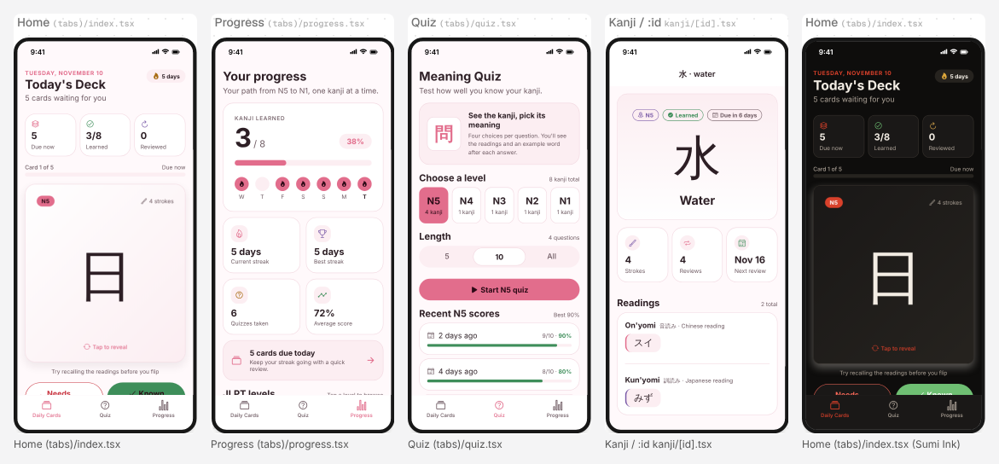

# KanjiDojo: 32.5 / 100

KanjiDojo has a genuinely working core loop: an SRS-style flashcard deck, a meaning quiz that persists results, and a progress screen with streaks, all in a polished light and Sumi Ink theme. It is missing three of the five product pillars entirely (onboarding, paywall and settings) and ships only 8 kanji, so it cannot personalize, monetize or retain anyone past the first session. Next, bundle a full N5/N4 kanji dataset, then add a short level-picking onboarding, a compliant paywall gating N3–N1, and a settings screen with subscription, legal and theme controls.

- App: KanjiDojo, version 1 (https://web-production-ea8f8.up.railway.app/projects/p_w03yd4b9minj4e)
- Evaluated 2026-11-10 with 2 independent judges (claude-opus-5-5), about $0.40

## Score by part

| Part | Points |
|---|---:|
| Onboarding | 0 / 15 |
| Paywall | 0 / 20 |
| Main app | 18.7 / 35 |
| Settings | 0 / 10 |
| Craft | 13.8 / 20 |
| **Total** | **32.5 / 100** |

## Criteria

Scores are 0–3 (averaged across judges), then capped by the deterministic checks.

| | Criterion | Points | Score | Judges | Evidence | Most valuable fix |
|---|---|---:|---|---|---|---|
| O1 | Fast to first value | 0 / 5 | 0 | 0, 0 | Deterministic finding: no onboarding. The app launches straight into the Daily Cards tab ('Today's Deck') with no flow to set a JLPT target or daily goal. | Add a skippable 3-step onboarding (target JLPT level → daily card goal → try one flashcard flip) with a progress indicator, ending on Daily Cards with the deck ready. |
| O2 | Steps that do work | 0 / 5 | 0 | 0, 0 | No onboarding exists, so no answers are collected. The quiz always defaults to `useState(5)` (N5) and the home deck ignores any learner level. | Ask for current/target JLPT level and daily new-card count, persist them, and use them to filter the home deck and preselect the quiz level. |
| O3 | Specific voice | 0 / 5 | 0 | 0, 0 | No onboarding copy exists. The only voice is in-app lines like 'Your path from N5 to N1, one kanji at a time.' | Write onboarding copy in the app's dojo voice (e.g. 'Which belt are you? N5 beginner … N1 master') with a live kanji demo instead of slides. |
| P1 | Clear value | 0 / 4 | 0 | 0, 0 | Deterministic finding: no paywall. There is no screen describing premium value. | Create a paywall route with an outcome headline ('Pass the N3 in 6 months') and 3 real premium features, e.g. full N1–N3 decks, unlimited quizzes and the stroke-order view. |
| P2 | Clear prices | 0 / 4 | 0 | 0, 0 | No paywall, so no prices, periods or trial terms are shown anywhere. | Show monthly and annual offers with price per period, trial length, a 'Best value' badge on annual and a clear selected state with 'Billed $X/year after 7-day trial'. |
| P3 | Required controls | 0 / 4 | 0 | 0, 0 | No paywall: there is no close button, Restore Purchases, renewal terms or Terms/Privacy links. | Add a header close button, a Restore Purchases button, an auto-renew disclosure paragraph and Terms/Privacy links to the paywall. |
| P4 | Honest and well timed | 0 / 4 | 0 | 0, 0 | No paywall is shown after onboarding or at any locked feature. | Present the paywall once after onboarding (dismissable) and when the user taps a locked N3–N1 level in the Quiz level picker; label it as test mode. |
| P5 | Entitlements wired | 0 / 4 | 0 | 0, 0 | Nothing checks isPremium. Every JLPT level chip in quiz.tsx is freely selectable and the Progress LevelCards are open. | Add an entitlement store with isPremium. Gate the N3–N1 levels and the 'All' quiz length behind it, pushing the paywall route when locked, and show purchase progress and error states. |
| M1 | Core loop first | 4.7 / 7 | 2 | 2, 2 | Home 'Today's Deck' puts the flashcard front and center with 'Tap to reveal' and Known/Needs review buttons that update next_review via nextReviewDate. However, in the screenshot the Known/Needs review buttons are clipped under the tab bar, below three stat tiles. | Move the three stat tiles below the card (or collapse them into the header line) so the flip card and Known/Needs review buttons fit above the tab bar on a standard phone. |
| M2 | Real content and states | 4.7 / 7 | 2 | 2, 2 | Seed data is realistic: 水 with スイ/みず readings, 6 quizzes with 90%/80% scores, a 5-day streak. Loading states exist (ActivityIndicator, 'Gathering your cards…'). But the whole deck is only 8 kanji across N5–N1 ('1 kanji' for N4–N1), and the home empty state says 'Once kanji are added' with no way to add any. | Ship a real seed deck (all ~80 N5 and ~170 N4 kanji at minimum) and give the empty states a working next action instead of referring to an add feature that doesn't exist. |
| M3 | Every control works | 4.7 / 7 | 2 | 2, 2 | Known/Needs review persist via update(). Skip, Up next picks and View details work. Quiz saves results via addResult and guards double saves with savingRef. Weak spots: the Length segment shows '10' selected while the note reads '4 questions', and there is no way to add kanji, which the empty-state copy implies. | Disable or hide length options larger than the level pool (show '4 (all)') so the selected control matches what will actually run. |
| M4 | Distinctive and shareable | 2.3 / 7 | 1 | 1, 1 | There are thematic touches: 問 badge on Quiz, 音読み/訓読み labels on the detail screen, a 'Sumi Ink' dark theme. But the quiz done phase and the progress screen have no share action, and the layout is a generic stat-tile flashcard template. | Add a shareable result card at quiz completion or streak milestones (big kanji, score, JLPT level, streak flames in sumi-ink style) with a Share button using the native share sheet. |
| M5 | Navigation conventions | 2.3 / 7 | 1 | 1, 1 | 3 tabs (Daily Cards, Quiz, Progress) and the kanji/[id] stack screen uses a native header ('水 · water'). Tab screens set headerShown:false with hand-built titles, and no settings screen is reachable from anywhere. | Add a gear button in the Daily Cards header that pushes a /settings stack route with a native header title. |
| S1 | Subscription | 0 / 4 | 0 | 0, 0 | Deterministic finding: no settings screen, so no plan status, upgrade, restore or manage-subscription controls. | Build a Settings screen with a Subscription section: plan status, Upgrade (opens paywall), Restore Purchases, and Manage Subscription linking to the App Store subscriptions URL. |
| S2 | Support, legal and about | 0 / 3 | 0 | 0, 0 | No settings screen: no contact support, privacy policy, terms or version anywhere. | Add an About section with Contact Support (mailto), Privacy Policy and Terms links (WebBrowser), and the app version from expo-constants. |
| S3 | Preferences that matter | 0 / 3 | 0 | 0, 0 | No preferences exist. The Sumi Ink theme appears in a screenshot, but the user has no visible way to switch themes, and there is no way to change level, daily goal or replay onboarding. | Add grouped preferences: Theme (Light/Sumi Ink/System), Target JLPT level, Daily new cards, Show romaji, and a 'Replay onboarding' row. |
| C1 | Layout and hierarchy | 3.3 / 5 | 2 | 2, 2 | Home has a clear focal flashcard with large 日, but three equal-weight bordered stat tiles compete above it. Progress is a stack of equally bordered cards (summary, 4 tiles, due card, level cards). | On Progress, drop the borders on the four stat tiles and render them as a plain two-column stat row so the 'Kanji learned 3/8' hero is the only boxed focal element. |
| C2 | Spacing and type | 3.3 / 5 | 2 | 2, 2 | A theme spacing scale is used, but with ad-hoc offsets (spacing.sm + 4, xs + 2, marginTop: 2) and hard-coded sizes (fontSize 32/40, lineHeight 18). The type ramp (headline/title/body/caption) is clear. Numbers like '3/8' and '72%' don't use tabular figures. | Add the missing scale steps (e.g. 12, 6) to the theme instead of sm+4/xs+2 arithmetic, and set fontVariant: ['tabular-nums'] on stat values and score counts. |
| C3 | Color and contrast | 2.7 / 4 | 2 | 2, 2 | Both the light pink theme and the Sumi Ink dark theme are legible. Weak spots: pink 'Tap to reveal' on pale pink and the near-invisible progress bar track ('Card 1 of 5') in light mode. Quiz score colors are paired with numbers, so color isn't the only signal. | Darken the primary used for small text on the pink background to reach 4.5:1, and raise the ProgressBar track contrast in the light theme. |
| C4 | Accessibility | 2 / 3 | 2 | 2, 2 | Pressables carry roles and labels ('Study 日', 'End quiz' with hitSlop) and font scaling isn't disabled. But 'Skip for now' and 'View details' have only theme.spacing.xs padding around a 16pt icon and caption text (~28pt tall), and the 30pt week circles fall below 44pt. | Give the Skip/View details links minHeight: 44 (or hitSlop of 10) and add accessibilityLabel to the flashcard toggle stating its flipped state. |
| C5 | No slop tells | 2.5 / 3 | 2.5 | 2, 3 | No emoji icons, gradients, TouchableOpacity or Alert confirmations; Ionicons are used throughout. The tab screens hand-roll their large titles with headerShown:false instead of using the navigator header. | Use the native large-title header (headerLargeTitle) for the tab screens instead of custom Text headers. |

## Issues, most severe first

- **critical** · paywall · (missing): There is no paywall, no entitlement check and no purchase path, so the app cannot make money. Every JLPT level and quiz length is free. *Fix:* Add a paywall route with monthly/annual offers, trial terms, close, Restore and legal links. Gate N3–N1 levels behind isPremium and open the paywall from the locked level chips.
- **critical** · settings · (missing): There is no settings screen: no subscription management, support, privacy policy, terms or version. Missing privacy/terms is an App Store review risk. *Fix:* Create /settings, reachable via a gear in the Daily Cards header, with Subscription, Preferences and About sections.
- **major** · onboarding · (missing): There is no onboarding. Users are dropped into a deck without choosing their JLPT level or daily goal, so nothing is personalized. *Fix:* Add a 3-step skippable flow (level, daily goal, one demo flip), persist the answers, and use them for the home deck and quiz default level.
- **major** · main · Daily Cards / Progress: The content is a toy: 8 kanji total, with N4–N1 at 1 kanji each, for an app promising N5→N1 progress. Users will exhaust it in minutes. *Fix:* Bundle a full JLPT kanji dataset with readings, meanings and example words, starting with complete N5 and N4.
- **major** · main · Daily Cards: The core action buttons (Known / Needs review) are clipped under the tab bar on first view because three stat tiles sit above the card. *Fix:* Move or condense the stat tiles so the flashcard and both answer buttons fit above the fold.
- **major** · main · Quiz (done phase): There is no shareable moment: quiz results and streaks have no share action or screenshot-worthy card. *Fix:* Add a styled result card (score, level, streak flames, a featured kanji) with a native Share button at quiz completion.
- **minor** · main · Daily Cards empty state: The 'Once kanji are added' empty state has no action, and the app has no add-kanji feature, so it is a dead end. *Fix:* Replace it with a 'Start N5 deck' or 'Take a quiz' button, or add an Add Kanji/browse-library flow.
- **minor** · main · Quiz setup: Length '10' shows as selected while the note says '4 questions', so the control contradicts the outcome. *Fix:* Disable length options that exceed the level pool, or relabel the option as 'All (4)'.
- **minor** · settings · (missing): The Sumi Ink dark theme exists but users cannot choose it. *Fix:* Expose a Theme picker (Light / Sumi Ink / System) in Settings, persisted in storage.
- **minor** · craft · Daily Cards: 'Skip for now' and 'View details' are small text links (~28pt targets). *Fix:* Set minHeight: 44 and a hitSlop on these Pressables.
- **minor** · craft · Progress: Every section is an equally bordered card, which flattens hierarchy, and stat numbers aren't tabular. *Fix:* Unbox the stat tiles into a plain grid and apply tabular-nums to all numeric values.
- **critical** · paywall · (missing): There is no paywall and no isPremium entitlement, so the app has no way to make money. All JLPT levels are free. *Fix:* Add a /paywall route with an outcome headline, monthly and annual prices with trial, Restore, close, renewal terms and legal links. Gate N4–N1 levels in Quiz and Progress behind isPremium.
- **critical** · settings · (missing): There is no settings screen: no subscription management, support, privacy/terms, version or preferences. *Fix:* Create a Settings stack route reached from a gear on Today's Deck, with Subscription, Study preferences, Appearance and About sections.
- **critical** · onboarding · (missing): There is no onboarding, so the app never learns the user's target JLPT level or daily pace. The Quiz always defaults to N5. *Fix:* Add a skippable 3-step flow (target level, daily count, reminder primer). Persist the answers and use them to build Today's Deck and preselect the quiz level.
- **major** · main · Home (tabs)/index.tsx: The Known / Needs review buttons, the core action, are cut off behind the tab bar on first view in both themes. The user must scroll to grade a card. *Fix:* Constrain the Flashcard height so the grading buttons are fully visible above the tab bar on a 6.1" screen.
- **major** · main · Quiz (tabs)/quiz.tsx: The content is too thin to be a real JLPT companion: 8 kanji total, with N4–N1 holding 1 kanji each. A quiz on those levels is meaningless and there is no way to add kanji. *Fix:* Seed the complete N5 list with readings and example words and a meaningful N4 set. Disable levels with fewer than 4 kanji, since 4 are needed for distractors.
- **major** · main · Quiz (done phase): There is no shareable moment: quiz results and streaks can't be shared. *Fix:* Render a styled result card (level, score, kanji learned) on quiz completion with a Share button that uses react-native Share or a view snapshot.
- **minor** · main · Home (tabs)/index.tsx: The empty state 'Your deck is empty. Once kanji are added…' has no action, and there is no add-kanji feature to fulfil it. *Fix:* Replace it with a 'Start N5 deck' button that loads the level's seed set.
- **minor** · main · Quiz (tabs)/quiz.tsx: The Length control shows '10' selected while the note says '4 questions', which is contradictory. *Fix:* Disable length options that exceed the level pool and fall back to 'All'.
- **minor** · craft · Home (tabs)/index.tsx: The 'Skip for now' and 'View details' links have roughly 24pt tap targets. *Fix:* Set minHeight: 44 and hitSlop: 12 on both Pressables.
- **minor** · craft · Progress (tabs)/progress.tsx: Seven bordered cards of near-equal weight compete for attention, and stat numbers aren't tabular. *Fix:* Unbox the 2×2 stat tiles, keep the 'Kanji learned' hero as the only card, and apply tabular-nums to numbers.
- **minor** · craft · Home (tabs)/index.tsx (light): Pink 'Tap to reveal' and pink caption text on a pale pink surface have weak contrast. *Fix:* Use a darker rose token for small primary text in the light theme so it meets 4.5:1.

## Deterministic checks that failed

- O1: The app has no onboarding. → caps at 0
- O2: The app has no onboarding. → caps at 0
- O3: The app has no onboarding. → caps at 0
- P1: The app has no paywall. → caps at 0
- P2: The app has no paywall. → caps at 0
- P3: The app has no paywall. → caps at 0
- P4: The app has no paywall. → caps at 0
- P5: The app has no paywall. → caps at 0
- S1: The app has no settings screen. → caps at 0
- S2: The app has no settings screen. → caps at 0
- S3: The app has no settings screen. → caps at 0
