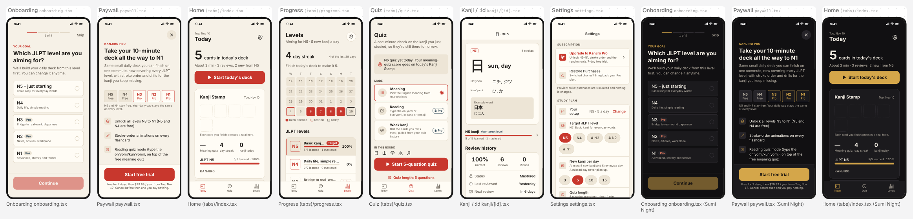

# Kanjiro: 84.6 / 100

Kanjiro has an unusually well-built shell: a 4-step onboarding that personalizes and lets users try a card, a compliant and honest paywall, real entitlement gating, complete settings and a clean light/dark theme system. What stops it from shipping is content and follow-through: the dictionary holds about seven kanji, the reminder feature is never scheduled, and the shareable Kanji Stamp is text-only. Next, load the full JLPT N5–N1 kanji set, wire expo-notifications to the reminder choices, and share the stamp as a rendered image. After that, bring the plan cards above the fold on the paywall.

- App: Kanjiro, version 1 (https://web-production-ea8f8.up.railway.app/projects/p_w39o273elcr2ov)
- Evaluated 2026-11-10 with 2 independent judges (claude-opus-5-5), about $0.70

## Score by part

| Part | Points |
|---|---:|
| Onboarding | 15 / 15 |
| Paywall | 17.4 / 20 |
| Main app | 25.7 / 35 |
| Settings | 9 / 10 |
| Craft | 17.5 / 20 |
| **Total** | **84.6 / 100** |

## Criteria

Scores are 0–3 (averaged across judges), then capped by the deterministic checks.

| | Criterion | Points | Score | Judges | Evidence | Most valuable fix |
|---|---|---:|---|---|---|---|
| O1 | Fast to first value | 5 / 5 | 3 | 3, 3 | Onboarding has 4 steps with a '1 of 4' progress bar and Skip. It ends via completeOnboarding() on Home, where 'Start today's deck' is the primary button. | After the last step, land users directly on the Today deck with the first card already queued, so the habit starts with no extra tap. |
| O2 | Steps that do work | 5 / 5 | 3 | 3, 3 | Target level and daily cap are saved with setAnswer and drive Home ('2 new from N5') and Levels ('Aiming for N5 · 5 new kanji a day'). Step 3 is a real try-it card (日) whose Know/Again result is saved to progress. | On the reminder step, call the OS notification permission prompt right after 'Remind me at…' so the explanation leads into a real permission request. |
| O3 | Specific voice | 5 / 5 | 3 | 3, 3 | Copy is written for this audience: 'Fits a two-stop commute, even in a rough week', 'Small and steady beats big and abandoned', 'No streak-guilt spam'. The heading is 'Which JLPT level are you aiming for?', not a welcome slide. | Keep the voice. Change the 'Welcome' Stack title to 'Set up Kanjiro' so even hidden metadata stays on brand. |
| P1 | Clear value | 4 / 4 | 3 | 3, 3 | Headline 'Take your 10-minute deck all the way to N1', an N5–N1 Free/Pro strip, and four feature rows. Each feature maps to code: locked levels, StrokeOrderRow, Reading mode and Weak kanji mode. | Shorten the feature rows to outcome phrasing (e.g. 'See every stroke animate') so all four fit above the fold. |
| P2 | Clear prices | 2.7 / 4 | 2 | 2, 2 | Offers show price per period, a 7-day trial, a 'Save 50%' badge, and a billing summary ('Free for 7 days, then $29.99 / year from Tue, Nov 17'). In the screenshot the plan cards sit below the fold, so the user sees a yearly charge without seeing which plan is selected. The lifetime badge 'Pass once, keep forever' is confusing. | Move 'Choose your plan' above the feature list, or make it compact enough that the selected offer shows next to the CTA. Rename the lifetime badge to 'Pay once'. |
| P3 | Required controls | 4 / 4 | 3 | 3, 3 | 44pt Close button top-right with a label, a Restore Purchases ghost button, renewalText with 24-hour auto-renew terms, and Terms of Use / Privacy Policy links. | Keep the Restore and legal links visible near the sticky CTA rather than only at the end of the scroll. |
| P4 | Honest and well timed | 2.7 / 4 | 2 | 2, 2 | There is no urgency, the close is visible immediately, and the 'Test mode: purchases are simulated' note is shown. The paywall opens from locked chips, Pro modes and the Levels lock row. Nothing shown routes to the paywall after completeOnboarding(). | After completeOnboarding, show the paywall once (dismissible) for users who picked N3–N1. That pick is the natural moment to offer Pro. |
| P5 | Entitlements wired | 4 / 4 | 3 | 3, 3 | buildDailyDeck receives isPremium. StrokeOrderRow has an onLocked=openPaywall handler. The quiz forces effectiveMode to 'meaning' for free users. Level rows open the paywall when locked. The paywall has an isPremium 'You're on Kanjiro Pro' state, a ready/loading state and busy status. | Show the purchase error inline under the CTA with a retry, and keep the selected offer highlighted. |
| M1 | Core loop first | 7 / 7 | 3 | 3, 3 | Today leads with '5 cards in today's deck · About 3 min' and a full-width 'Start today's deck'. Finishing the deck goes straight to 'Take today's quiz'. The loop matches the brief. | After the last card, auto-start the 5-question quiz with a 'Skip quiz' option, so the loop finishes in one flow. |
| M2 | Real content and states | 2.3 / 7 | 1 | 1, 1 | Loading and empty states are well written. But the seeded dictionary is tiny: Levels shows N5 '5/5 learned' and N4 '0/2 learned', so the app has about 7 kanji against roughly 2,000 for N5–N1. Home claims '2 new from N5' while the same screen says 'JLPT N5 5/5 learned · 100%'. | Ship the full JLPT kanji set (about 80 N5 and 170 N4 free, N3–N1 Pro) with on/kun readings and an example word each. Make 'learned' and 'new' use one definition so the counts agree. |
| M3 | Every control works | 4.7 / 7 | 2 | 2, 2 | Know/Again persist through applyReview, quiz results update progress and the session, settings chips persist, and reset uses an inline confirm. However 'Remind me at 6:00 PM' (onboarding) and the Settings 'Daily reminder' chips only call setAnswer. No notification permission or scheduling appears in the code. | Use expo-notifications: request permission when the user picks a time, schedule a daily trigger at reminderTime, cancel it on 'Off', and skip it on days the deck is finished. |
| M4 | Distinctive and shareable | 4.7 / 7 | 2 | 2, 2 | The Kanji Stamp card on Home has a seal grid, quiz score, streak, an N5 progress bar and a 'KANJIRO' wordmark, which is a real point of view. Before study it is five dashed empty squares. shareStamp shares only a text message, not the card image. | Render filled stamps as red hanko-style seals, and share the card as an image using react-native-view-shot plus Share. |
| M5 | Navigation conventions | 7 / 7 | 3 | 3, 3 | Three tabs (Today, Quiz, Levels). Settings is reachable from a gear on Today and Levels. Settings and Kanji detail use navigator header titles ('Settings', '日 · sun'). The paywall is a route with a close button. | Present the paywall with presentation: 'modal' so swipe-down dismiss works on iOS. |
| S1 | Subscription | 4 / 4 | 3 | 3, 3 | The Subscription section has an Upgrade row with a trial mention (or a Pro status row with since-date), Restore Purchases with inline outcome text, and Manage subscription linking to the App Store or Play subscriptions. | For premium users, show the renewal date and plan price in the status row. |
| S2 | Support, legal and about | 3 / 3 | 3 | 3, 3 | Deterministic checks confirm contact support, Privacy, Terms and the app version in Settings. The app has no accounts. | Prefill the support email with the app version and device so learners' bug reports are actionable. |
| S3 | Preferences that matter | 2 / 3 | 2 | 2, 2 | Grouped sections (Study plan, Reading and reminders, Appearance, Study data) cover target level, cap, quiz length, a romaji switch, themes and 'Your setup · Change', which replays onboarding. The Daily reminder chips save a value that nothing appears to act on. | Wire the reminder chips to real scheduled notifications so every setting in the list changes behavior. |
| C1 | Layout and hierarchy | 4.2 / 5 | 2.5 | 2, 3 | Home has a clear first read: a big '5' and the red CTA. Paywall hierarchy is strong. Levels and Settings stack many equally bordered boxes, and the Quiz tab has a boxed banner plus three boxed mode cards plus a CTA. | On Quiz, drop the info banner box and make the mode list a single grouped list, leaving the Start button as the only heavy element. |
| C2 | Spacing and type | 3.3 / 5 | 2 | 2, 2 | tabular-nums are used on counts and the type ramp is clear. On Levels, row titles truncate ('Basic kanj…', 'Daily life, simple re…'). In Settings, 'Your setup' wraps to two lines next to its value. | In LevelRow, put the blurb on its own line under the level badge (numberOfLines 2) instead of truncating it next to the Target pill. |
| C3 | Color and contrast | 4 / 4 | 3 | 3, 3 | The light Washi and dark Sumi Night themes both stay legible on the onboarding, paywall and home screenshots. Pro tags, calendar states and quiz progress use text, borders or legend labels in addition to color. | Darken the disabled Continue fill in the light theme. Pale salmon with white text is hard to read even when disabled. |
| C4 | Accessibility | 3 / 3 | 3 | 3, 3 | Icon buttons (Settings gear, Close, End quiz, End session) are 44×44 with accessibilityLabel. Chips carry descriptive labels, the calendar has a summary label, and font scaling is never disabled. | Add accessibilityState={{selected}} to OptionRow and the offer cards so screen readers announce the current choice. |
| C5 | No slop tells | 3 / 3 | 3 | 3, 3 | Ionicons throughout, Pressable instead of TouchableOpacity, no gradients or emoji, router-based modals, and inline confirmations instead of Alert. | Keep it. Swap the generic 'sparkles' upgrade icon for a seal/hanko mark that fits the brand. |

## Issues, most severe first

- **critical** · main · Levels / Today: The kanji dictionary holds about 7 characters (N5 5/5, N4 0/2), so a learner at 5 a day exhausts free content in under two days and N3–N1 'Pro' levels are effectively empty. That is a refund magnet for a paid kanji app. *Fix:* Seed the full JLPT N5–N1 list with on'yomi, kun'yomi, meaning, stroke count and one example word per kanji, bundled as JSON.
- **major** · main · Onboarding step 4 / Settings Daily reminder: 'Remind me at 6:00 PM' and the reminder chips only store a string. No notification permission is requested and nothing is scheduled, so the promised commute nudge never arrives. *Fix:* Integrate expo-notifications: request permission on choose, schedule a daily local notification at reminderTime, cancel it on Off, and suppress it once today's deck is finished.
- **major** · main · Home (Today): Home says '3 reviews, 2 new from N5' while the Stamp card shows 'JLPT N5 5/5 learned · 100%'. These contradictory numbers undermine trust in the progress tracking. *Fix:* Count 'learned' only for kanji with a successful review, or don't label cards 'new' once a progress record exists. Use one helper for both.
- **major** · paywall · Paywall: Plan cards are below the fold. The visible CTA 'Start free trial · $29.99/year' commits to yearly before the user has seen the Monthly or Lifetime options. *Fix:* Move the offer cards above the feature list, or into the sticky footer as a compact segmented selector next to the CTA.
- **major** · main · Home Kanji Stamp: The share moment is weak. Before study the stamp is five dashed boxes, and Share sends plain text instead of the stamp image the brief calls for. *Fix:* Capture the KanjiStampCard with react-native-view-shot and share the PNG. Style studied kanji as red hanko seals.
- **minor** · paywall · Paywall (code): The paywall is never shown after onboarding, even when the user picks a Pro level (N3–N1). This misses the highest-intent conversion moment. *Fix:* In completeOnboarding, if the target level is not free and the user is not premium, router.push('/paywall') once.
- **minor** · paywall · Paywall offers (monetization.ts): The lifetime badge 'Pass once, keep forever' reads as a typo or mistranslation. *Fix:* Change the badge to 'Pay once, yours forever' or 'Best value'.
- **minor** · craft · Levels: Level rows truncate their descriptions ('Basic kanj…', 'Daily life, simple re…') because the Target pill and percentage crowd the title line. *Fix:* Show the level name as the title and move the blurb to a second line with numberOfLines={2}.
- **minor** · craft · Quiz: Boxed banner, three bordered mode cards and a red CTA all compete for weight, and the 'Quiz length' link sits below the fold under the Start button. *Fix:* Turn the banner into plain muted text, and put quiz length as a chip row inside the mode section above Start.
- **minor** · craft · Onboarding (light theme): The disabled Continue button is pale salmon with white text, which has low contrast and is hard to read. *Fix:* Use a neutral disabled fill (surfaceAlt) with textMuted label text for disabled buttons.
- **minor** · settings · Settings Study plan: 'Your setup' wraps onto two lines beside 'N5 · 5 a day Change', so the row looks cramped and duplicates the level and cap rows directly below it. *Fix:* Rename the row to 'Replay setup questions', drop the duplicate value, and keep 'Change' as the trailing action.
- **critical** · main · Levels / Today: The kanji dataset is tiny: N5 shows 5/5 and N4 shows 0/2. Free users will exhaust the product in about two days, and the paywall's promise of 'hundreds more' is unverifiable. *Fix:* Ship the full JLPT kanji lists per level with on'yomi, kun'yomi, meaning, stroke count and one example word in the seed collection.
- **major** · main · Today (Kanji Stamp): The header says '3 reviews, 2 new from N5' while the stamp bar says 'JLPT N5 5/5 learned · 100%', a visible contradiction on the home screen. *Fix:* Make levelStats and buildDailyDeck share one definition of learned/new. Count 'learned' only for cards marked Know at least once, or exclude already-progressed kanji from 'new'.
- **major** · main · Onboarding step 4 / Settings Daily reminder: 'Remind me at 6:00 PM' and the reminder chips only save an answer. No notification permission is requested and nothing is scheduled, so the habit nudge the app promises never fires. *Fix:* Integrate expo-notifications: ask permission on that button and schedule a daily repeating local notification at reminderTime. Skip it when today's deckFinished is true, and cancel it on Off.
- **major** · paywall · Onboarding → Today: The paywall is never presented after onboarding, even when the user picks a Pro level (N3–N1). The highest-intent moment is lost. *Fix:* In finish(), after completeOnboarding(), call openPaywall() once when the chosen level is locked, or always as a dismissible sheet.
- **minor** · paywall · Paywall: The plan cards sit below four feature rows, so the CTA 'Start free trial' is visible before the user ever sees which plan is selected. Yearly lacks a monthly equivalent, and the Lifetime badge 'Pass once, keep forever' is awkward. *Fix:* Place 'Choose your plan' directly under the headline and level strip. Add '$2.50/mo' to Yearly and rename the Lifetime badge to 'One-time'.
- **minor** · main · Today (Kanji Stamp): Sharing sends a plain text string, and the stamp's empty state is five dashed boxes, so the share moment isn't screenshot-worthy until late in the day. *Fix:* Capture the KanjiStampCard with react-native-view-shot and pass the image URI to Share. Render today's planned kanji as faded seals until they're stamped.
- **minor** · craft · Levels: Level descriptions truncate ('Basic kanj…', 'Daily life, simple re…') because the Target and Pro badges share the title line. *Fix:* Allow numberOfLines={2} on the LevelRow title, or move badges to the subtitle line.
- **minor** · settings · Settings › Study plan: The 'Your setup → Change' row duplicates the level and cap pickers right below it and restarts the whole onboarding, including the demo card that writes progress again. *Fix:* Rename it 'Replay welcome' in an About group and keep the inline pickers as the way to edit answers.
- **minor** · paywall · Paywall: Feature copy is pasted from the plan, e.g. 'Unlock all levels N3 to N1 (N5 and N4 are free)', and repeats the Free/Pro level strip directly above it. *Fix:* Rewrite features as outcomes, e.g. 'N3–N1 in the same 5-a-day deck', 'Watch each stroke drawn in order', 'Type readings to prove you know them', 'A deck of only your misses'.
- **minor** · main · Quiz: record() writes progress with fire-and-forget void progressCol.update/add. A failed write silently loses the answer, while the Today screen handles save errors. *Fix:* Await the write in record() and show an inline 'Couldn't save, retry' message under the choices on failure, as Today's mark() does.

## Deterministic checks that failed

None.
