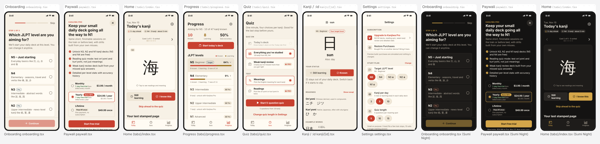

# Kanjiwa: 93.3 / 100

Kanjiwa is a well-crafted, honest app with a fast personalizing onboarding, a compliant paywall whose premium features are actually gated, a clear flashcard-first home and complete settings, all in a calm themed design that works in light and dark. What stands between it and paying users is content: about 47 kanji in total, with only around 22 behind the Pro wall, so both the daily habit and the N1 promise collapse within a week. Ship the full JLPT kanji dataset first, then share the stamped page as an image and add a daily reminder to make the loop sticky.

- App: Kanjiwa, version 1 (https://web-production-ea8f8.up.railway.app/projects/p_bithjb2vm2wnif)
- Evaluated 2026-11-10 with 2 independent judges (claude-opus-5-5), about $0.65

## Score by part

| Part | Points |
|---|---:|
| Onboarding | 15 / 15 |
| Paywall | 19.3 / 20 |
| Main app | 31.5 / 35 |
| Settings | 10 / 10 |
| Craft | 17.5 / 20 |
| **Total** | **93.3 / 100** |

## Criteria

Scores are 0–3 (averaged across judges), then capped by the deterministic checks.

| | Criterion | Points | Score | Judges | Evidence | Most valuable fix |
|---|---|---:|---|---|---|---|
| O1 | Fast to first value | 5 / 5 | 3 | 3, 3 | Onboarding has three steps with a segmented progress bar and a 'STEP 1 OF 3' label. A Skip button sits in the top bar. The last step's 'Start my first deck' calls completeOnboarding(), which lands on the Today tab with the flashcard already up. | No change needed; optionally preselect the 'Recommended' 5-kanji option so step 2 is one tap. |
| O2 | Steps that do work | 5 / 5 | 3 | 3, 3 | Step 1 saves the target JLPT level, step 2 saves the daily count, and step 3 is a try-it card for 日 whose Known/Learning mark is written to the real card. Home shows 'N4 · 5 kanji', Progress shows 'Aiming for N5' and Settings shows the same plan. | Ask for a preferred study time and use it to schedule a daily reminder. |
| O3 | Specific voice | 5 / 5 | 3 | 3, 3 | The copy is written for this learner: 'About 2 minutes · fits between two train stops', 'Small and steady beats big and abandoned. Every day ends with a finished deck, never a backlog.' Level options use example kanji (談, 復, 識). | Keep this voice; carry it into the onboarding finish line, e.g. 'Your first page is waiting'. |
| P1 | Clear value | 3.3 / 4 | 2.5 | 2, 3 | The headline 'Keep your small daily deck going all the way to N1' is outcome-led, and the four features are each gated in code (Quiz Readings/Weak PRO badges, the Progress accuracy section, the N3–N1 lock). However, Progress shows N3 has 9 kanji, N2 7 and N1 about 6, so 'Unlock N3, N2 and N1 decks' sells roughly 22 cards. | Ship the full JLPT kanji lists, then put real counts in the first bullet (e.g. '~1,700 N3–N1 kanji'). |
| P2 | Clear prices | 4 / 4 | 3 | 3, 3 | The offer cards show '$3.99 / month', '$24.99 / year' with '$2.08 / month', and '$49.99 once'. They also show '7-day free trial then billed every year' and a 'Save 48%' badge. The selected Yearly card has a red ring, and the line under the CTA reads 'Free today. $24.99 on Tue, Nov 17, then every year.' | Rename the 'Pass N1 once' lifetime badge to something factual such as 'Best for the long haul'. |
| P3 | Required controls | 4 / 4 | 3 | 3, 3 | There is a 44pt close button at the top right and a 'Restore Purchases' ghost button. The renewalText includes the 24-hour cancellation clause, and Terms of Use and Privacy Policy links are present. | None required. |
| P4 | Honest and well timed | 4 / 4 | 3 | 3, 3 | The paywall appears after onboarding via the platform and from locked chips and rows (Quiz PRO rows, Progress N3 row, Settings level chips). The close button is visible immediately, there is no countdown, and the test-mode note reads 'Test mode: purchases are simulated, nothing is charged.' | None required. |
| P5 | Entitlements wired | 4 / 4 | 3 | 3, 3 | quiz.tsx gates the weak source and reading mode on isPremium. progress.tsx renders accuracy only when isPremium and calls openPaywall for locked levels. The paywall shows a loading state on 'purchasing', an inline error row, and an 'You have Kanjiwa Pro' already-premium state. | After a successful purchase, return the user to the feature they tapped (e.g. start the reading quiz) instead of only dismissing. |
| M1 | Core loop first | 7 / 7 | 3 | 3, 3 | The Home 'Today's kanji' screen opens directly on flashcard 海 with 'Still learning' / 'I know this' buttons, card dots and 'Skip ahead to the quiz'. A completed day becomes the stamped page card. | Add a daily reminder so the loop has a trigger to come back. |
| M2 | Real content and states | 5.8 / 7 | 2.5 | 2, 3 | Loading labels such as 'Laying out today's deck' and 'Mapping your kanji from N5 to N1' are good, and empty states have actions. But the seed is only 47 kanji total (Progress: 14 N5, 11 N4, 9 N3, 7 N2), so a 5-a-day learner exhausts the free levels in about a week. | Replace the seed with the full JLPT N5–N1 kanji set (readings, meanings, example words) generated from KANJIDIC2 or a JLPT list. |
| M3 | Every control works | 7 / 7 | 3 | 3, 3 | Marking updates card status and session progress, and settings pickers write answers that Home and Quiz read. Theme switching works, reset uses an inline confirm, and there are no empty handlers. One small defect: settings handleRestore reads a stale `error` from the render closure. | Have restorePurchases return a failure reason and show that, instead of reading `error` from the closure. |
| M4 | Distinctive and shareable | 4.7 / 7 | 2 | 2, 2 | There is a clear point of view: a capped daily deck, the 'Your last stamped page' hanko card, and Washi/Sumi/Aizome themes. But share() sends only a plain-text summary ('Kanjiwa · Nov 10 / Kanji: …'), so the stamped page itself never leaves the app. | Capture DailyPageCard with react-native-view-shot and share the image (with the text as fallback). |
| M5 | Navigation conventions | 7 / 7 | 3 | 3, 3 | There are three tabs (Today, Quiz, Progress). A settings gear sits on Home and Progress. Kanji/[id] and Settings use navigator headers ('日 · sun', 'Settings'), and the paywall is a route. | Hide the tab bar during an active quiz so the 'End quiz' close is the only exit. |
| S1 | Subscription | 4 / 4 | 3 | 3, 3 | The Subscription section has 'Upgrade to Kanjiwa Pro' (Active row with plan and since-date when premium), 'Restore Purchases', and 'Manage subscription' linking to the App Store or Google Play subscriptions page. | None required. |
| S2 | Support, legal and about | 3 / 3 | 3 | 3, 3 | Support rows include a 'Contact support' mailto, 'Privacy Policy' and 'Terms of Use', plus the app version (deterministic pass). There are no accounts, so no sign-out is needed. | Prefill the support email body with the app version and device OS. |
| S3 | Preferences that matter | 3 / 3 | 3 | 3, 3 | Settings groups Study plan (target level, kanji per day, quiz length, and 'Change' to replay onboarding), Flashcards (Show romaji switch), Appearance (theme), and Your progress (reset with inline confirm). Each changes Home and Quiz behaviour. | Add a 'Daily reminder' time row in Study plan. |
| C1 | Layout and hierarchy | 4.2 / 5 | 2.5 | 3, 2 | Home has one focal kanji card and one filled primary button. Progress leads with three big numbers and a single red CTA. The paywall reads headline, then features, then plans, then CTA. | On Quiz setup, make the selected source and mode rows less boxy (rows without borders) so the Start button dominates. |
| C2 | Spacing and type | 3.3 / 5 | 2 | 2, 2 | Spacing tokens (xs/sm/md/lg/xl) and tabular-nums are used throughout, and the type ramp runs caption/body/title/headline/display. However, on Home the 'Still learning' button label wraps to two lines next to the one-line 'I know this', making the pair look uneven. | Shorten the label to 'Learning' or reduce horizontal padding so both action labels sit on one line. |
| C3 | Color and contrast | 4 / 4 | 3 | 3, 3 | Both the Washi light and Sumi Night dark screenshots are legible. The gold primary button uses dark text and the Pro badges keep contrast. Status uses text ('9 known · 5 learning') alongside color bars. | Add a text or stamp alternative to the color-only known/learning dots above the flashcard. |
| C4 | Accessibility | 3 / 3 | 3 | 3, 3 | Icon buttons carry labels ('Open settings', 'Previous card', 'Close', 'Back to the previous step'). The onboarding progress bar has role and value, and 44pt targets are used in most places. Font scaling is not disabled. | Raise the quiz 'End quiz' button from 36pt to 44pt. |
| C5 | No slop tells | 3 / 3 | 3 | 3, 3 | Icons are Ionicons rather than emoji, and there is no gradient hero, TouchableOpacity or Alert confirmation; reset uses an inline confirm. Stack screens use navigator headers. | None required. |

## Issues, most severe first

- **critical** · main · Progress / seed data: The whole app ships about 47 kanji (14 N5, 11 N4, 9 N3, 7 N2, about 6 N1). A learner at 5 a day finishes everything free in roughly 5 days, and Pro adds only about 22 more. The habit dies within two weeks and paying users feel cheated. *Fix:* Import the full JLPT kanji list with on/kun readings, meanings and example words (e.g. from KANJIDIC2 plus a JLPT level map) as the seed collection.
- **major** · paywall · Paywall: The paywall sells 'N3, N2 and N1 decks' and a lifetime badge 'Pass N1 once' while N1 contains only a handful of cards. This misleading value claim invites refunds and review complaints. *Fix:* Once full data ships, state real counts in the feature bullet. Replace the 'Pass N1 once' badge with a factual one.
- **major** · main · Home: The share moment shares only a plain-text summary through Share.share. The hanko-stamped page card, the one thing worth posting, is never shared as an image. *Fix:* Wrap DailyPageCard in a ViewShot ref and share the captured PNG via expo-sharing, keeping the text as the message.
- **major** · settings · Settings: A daily-habit app for commute and bedtime study has no reminder or notification option. Nothing brings the user back to protect the streak. *Fix:* Add a 'Daily reminder' row with a time picker. Explain it before requesting notification permission, and schedule a local notification with expo-notifications.
- **minor** · main · Quiz: 'Today's deck' is disabled with 'Draw today's deck on the Today tab first', because the daily session is only created in the Today screen's useEffect. Opening Quiz first hides the core quiz. *Fix:* Move daily-deck creation into a shared data hook that Quiz and Today both call.
- **minor** · main · Home: Target is N5 (per Progress/Settings) yet today's deck is labeled N4, with no explanation. The 5 N5 cards still marked learning may not be recycled. *Fix:* Fill the deck with due learning cards from the target level first, and show a one-line note like 'N5 sorted — moving on to N4' when spilling over.
- **minor** · main · Quiz → Home stamped page: 'Retake quiz' overwrites today's quizScore with the latest attempt, so a worse retake lowers the score on the shareable page. *Fix:* Store the best score of the day (Math.max) on the session.
- **minor** · settings · Settings: handleRestore builds its failure message from the `error` value captured at render time, so it can show null or a stale error after a failed restore. *Fix:* Return a typed result `{ ok, error }` from restorePurchases and display that error.
- **minor** · craft · Home: The 'Still learning' label wraps to two lines while 'I know this' stays on one, making the core action pair look unbalanced. *Fix:* Use 'Learning' as the label or reduce button padding so both fit on one line.
- **minor** · craft · Quiz (playing): The 'End quiz' close button is 36×36pt, under the 44pt target. *Fix:* Set width and height to 44.
- **major** · main · Today (DailyPageCard share): The planned share moment is a hanko-stamped page image, but onShare calls Share.share({ message }) with a plain-text summary, so what users post looks like a log line, not the designed card. *Fix:* Wrap DailyPageCard in a ref, capture it with react-native-view-shot's captureRef, and share the image URI (keep the text as message) through Share.share or expo-sharing.
- **minor** · main · Today: The user's target is N5 (Progress: 'Aiming for N5'), yet the Today chip says 'N4 · 5 kanji' with no explanation. This reads as a bug even though N5 has no new cards left. *Fix:* When the deck level differs from the target, append a short note under the chips, e.g. 'N5 all sorted · moving on to N4'.
- **minor** · main · Quiz: The 'Today's deck' source is disabled with 'Draw today's deck on the Today tab first'. The session is only created by an effect in the Today screen, so the quiz depends on another tab having mounted. *Fix:* Move the daily-session creation into a shared hook or the data layer (e.g. ensureTodaySession) called by Today, Quiz and Progress.
- **minor** · settings · Settings › Restore Purchases: handleRestore reads `error` from the render closure after awaiting restorePurchases(), so the failure note can show a stale or missing store error. *Fix:* Have restorePurchases return { ok, error } (or read it from a ref) and build the note from that return value.
- **minor** · paywall · Paywall: The billing summary ('Free today. $24.99 on Tue, Nov 17...') is clipped below the CTA at first glance. Restore and the renewal terms require scrolling. *Fix:* Reduce the feature list gap and the subheading to two lines so the CTA plus billing summary sit fully above the fold on a 6.1" screen.
- **minor** · craft · Today: 'Still learning' wraps to two lines while 'I know this' is one line, giving the core decision pair unequal visual weight. *Fix:* Rename the button to 'Learning' (consistent with onboarding) or reduce its icon/padding so both labels fit on one line.
- **minor** · craft · Progress: The screen stacks a primary button, a bordered levels box and a bordered accuracy box, so it reads as a pile of cards rather than one hierarchy. *Fix:* Remove the container borders on the levels list and accuracy panel and use section spacing (spacing.xl) plus titles for grouping.
- **minor** · craft · Quiz (playing): The 'End quiz' close button is 36×36pt, below the 44pt target size used elsewhere. *Fix:* Set width/height to 44 to match the paywall and onboarding back buttons.

## Deterministic checks that failed

None.
